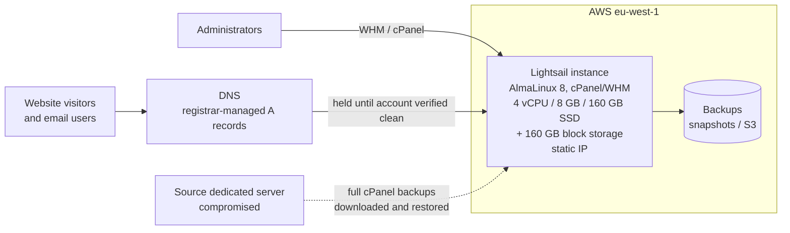

# cPanel Hosting Migration to Amazon Lightsail, with Malware Incident Response

> Client, provider and domain names are intentionally omitted. All indicators and identifiers have been generalised.

## Summary

Migrated a multi-tenant cPanel/WHM hosting environment (originally ~80 domains, **61 cPanel accounts** migrated) from a South African dedicated server to **Amazon Lightsail**. The source server was 92% full and had no room to grow.

Pre-go-live verification showed the source server had been compromised **before** the migration, and the infection had come across in the restored backups. The project turned into a security remediation: **8 malware families, ~23,500 injector files removed**, 37 accounts cleaned in place and 24 rebuilt from known-good sources. DNS cutover was held until each account was verified clean. All 61 accounts were cut over and live on **5 August 2026**, about six weeks after the compromise was found (21 June 2026).

| | |
|---|---|
| Role | Led the migration, incident response, documentation and cleanup tooling, working in a two-person team with one intern |
| Platform | AWS Lightsail (eu-west-1), AlmaLinux 8, cPanel/WHM |
| Scope | 61 cPanel accounts, mostly WordPress, plus email |
| Outcome | All 61 accounts cut over and live on 5 August 2026, each only after being verified clean |

## Context

| Area | Detail |
|---|---|
| Source | Dedicated server, AlmaLinux 8, cPanel/WHM, 4 cores, ~5.4 GB RAM |
| Storage | 286 GB volume, 250 GB used (92%) |
| Workload | ~80 domains at the start; WordPress sites and mailboxes |
| Cost | About R2,470 per month |
| Constraint | No SSH or root access to the source, so the cPanel transfer tool could not be used |

## Options and decision

| | Lightsail + cPanel | EC2 + EBS + cPanel |
|---|---|---|
| Specs | 4 vCPU / 8 GB / 160 GB SSD + 160 GB block storage | t3.xlarge, 16 GB, 500 GB gp3 |
| Estimated run cost | About R1,912 per month | About R2,623 per month |
| Scalability | Limited | High |
| Decision | **Chosen** | Kept as the growth path |

See [ADR-001](./ADR-001-lightsail-vs-ec2.md).

## Architecture

## Approach

1. Audit domains, accounts and disk usage on the source.
2. Provision the Lightsail instance, attach block storage, assign a static IP, and install cPanel/WHM.
3. Download full account backups (no SSH on the source, so no transfer tool).
4. Restore the backups on the new server, with DNS still pointing at the old server.
5. Pre-go-live verification: sites, databases, email and TLS.
6. Remediate, then cut over account by account.

## What went wrong

Webmail returned a WordPress-style "Coming Soon" page and certificate issuance (AutoSSL) failed across accounts. The server configuration was healthy. The cause was malware.

- A planted `.htaccess` forced `index.html` ahead of `index.php` and rewrote all requests, including error pages and validation paths, to a fake "Coming Soon" page. The antimalware scanner did not flag it.
- A JavaScript redirect injector had been written into **every** directory, including mail, stats and `.well-known`. That is why certificate validation failed.
- Deeper inspection kept finding more. In total **8 malware families** turned up, among them PHP backdoor loaders, injected core and plugin files, hidden webshell kits in WordPress core, a remote-eval backdoor, disguised-image payloads and a spam-relay mailer.

## Response

| Phase | What was done |
|---|---|
| Contain | Held all DNS cutover, so no live traffic reached an unverified account. Quarantined confirmed webshells. Notified the client that this was a security incident, not just a migration issue, with POPIA implications because some sites held legal, medical and ID-verification data. |
| Triage | Classified all 61 accounts from filesystem evidence into **clean in place** (loader and redirect injector only) or **rebuild** (deep or multi-payload infection). |
| Clean | 37 accounts cleaned with scripted, per-account steps. A whole-home sweep removed injector copies outside the web root. |
| Verify | Compared each WordPress install file by file against the official release **of the same version**. That caught malware that signature scanners missed. Re-ran every check to zero before marking an account clean. |
| Rebuild | 24 accounts rebuilt from fresh WordPress core, plugins and themes from official sources. Only the database and uploads were carried over, and only after scanning them. |
| Go-live | Rotated all credentials, routed mail locally, lowered DNS TTL and cut over. An account went live only when it had been cleaned and verified, credentials rotated, mail routed and DNS changed. |

The scanner was detection-only because the client did not have the budget for a paid clean-up licence, so the cleanup was manual and scripted. The [cleanup procedure](./cleanup-procedure.md) is documented generically.

## Results

- 61 accounts live and clean; all live on 5 August 2026, about six weeks after the compromise was found.
- ~23,500 injector files removed; 8 malware families identified and documented.
- 24 accounts rebuilt, 37 cleaned in place, 0 unaccounted for.
- Run cost estimate fell from about R2,470 to about R1,912 per month (see ADR-001).
- No live site served unverified content during the incident.
- Some clients chose to leave the relationship as a result of the incident.

## Lessons learned

- **Check the source before restoring from it.** A dedicated server with no root access for the migrator is a risk. Scan backups, or restore into an isolated environment first.
- **Never cut DNS over to an account you haven't verified.** Holding cutover turned a potential public incident into a contained one.
- **Signature scanning isn't enough.** Several families were found only by comparing core files against the official release, and the version must match or you get thousands of false differences.
- **Look past the web root.** Injectors were in mail, stats and `.well-known` directories, and a sweep of the docroot alone would have missed them.
- **Rebuild beats disinfect for deep infections.** If core and plugin files are injected, you can't reliably strip them.
- **Treat "Coming Soon" and certificate failures as signals, not as plugin problems.** I first suspected a plugin and corrected that once the file-level evidence came in.
- **Document as you go.** A per-account triage sheet and a signature list made each round faster and gave the client an audit trail.

## Skills demonstrated

AWS Lightsail and EC2 sizing, cPanel/WHM administration, AlmaLinux, Apache and `.htaccess`, DNS and TLS (Let's Encrypt/AutoSSL), malware incident response, forensic comparison against known-good sources, Bash scripting and automation, migration planning, risk management and stakeholder communication, POPIA awareness.
