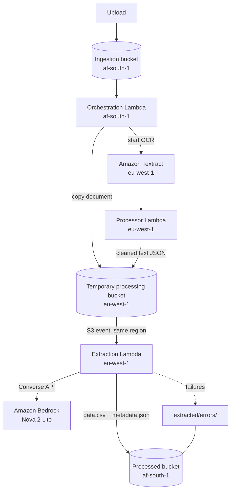

# AI Document Extraction Pipeline (Cross-Region, POPIA-Aware)

> Proof-of-concept implementation. Client, account, bucket and resource names are intentionally omitted or replaced with placeholders.

## Summary

A serverless pipeline that takes procurement and compliance documents (for example B-BBEE certificates, tax clearance certificates, invoices and quotes), runs OCR and AI extraction, and returns **one structured CSV per document**.

Data at rest is kept in **`af-south-1` (Cape Town)** to support POPIA data-residency requirements. Processing runs in **`eu-west-1` (Ireland)** because the foundation models needed for text extraction were not available in Cape Town at the time. The design keeps the permanent record in South Africa and uses Ireland for processing only.

| | |
|---|---|
| Role | Designed and implemented the backend and AWS infrastructure (separate developers built the front end) |
| Regions | `af-south-1` (storage), `eu-west-1` (processing) |
| Services | S3, Lambda, Textract, Amazon Bedrock (Nova 2 Lite), IAM, CloudWatch |
| Output | One CSV and one audit-metadata JSON per document |
| Status | Proof of concept, validated end to end on a sample certificate |

## Problem

The platform being modernised relied on a hybrid stack with a separate document-management service. The business needed documents to be turned into structured fields (supplier name, certificate level, expiry date, totals and so on) rather than just categorised, with:

- Data residency in South Africa for personal and business information
- One isolated output per document, so customer data is not mixed
- An audit trail for compliance
- Low per-document cost

## Architecture

### Flow

1. A document is uploaded to the **ingestion bucket** in `af-south-1`.
2. The **orchestration Lambda** copies it to a **temporary processing bucket** in `eu-west-1` and starts Textract.
3. **Textract** reads the document in `eu-west-1`.
4. The **processor Lambda** cleans the OCR output and writes it as JSON to the temporary bucket.
5. That write triggers the **extraction Lambda** through an S3 event in the same region.
6. The extraction Lambda calls **Bedrock (Nova 2 Lite)** through the Converse API. A two-step prompt identifies the document type and extracts the fields defined for it.
7. The result is written to the **processed bucket** in `af-south-1` as `extracted/<document-type>/<document-id>/data.csv` plus `metadata.json`. Failures go to `extracted/errors/`.

## Document types and fields

Eight types are supported, each with its own schema:

| Type | Example fields |
|---|---|
| B-BBEE certificate | company name, level, certificate number, issue and expiry date, issuing agency, scorecard values |
| Tax clearance | company name, tax number, issue and expiry date, status, reference |
| Invoice | vendor, invoice number, date, line items, total, currency |
| Quote | supplier, quote number, validity period, line items, total, terms |
| Purchase order | PO number, supplier, delivery date, line items, total |
| Contract | parties, effective and expiry date, value, key terms |
| CV / supplier profile | name, contact, skills, experience, education |
| Other | summary, key points |

## Key design decisions

- [ADR-001: Split storage and processing across two regions](./ADR-001-cross-region-processing.md)
- [ADR-002: Choosing the extraction model](./ADR-002-model-selection.md)

## Challenges and fixes

| Problem | Cause | Fix |
|---|---|---|
| S3 trigger failed to create across regions | S3 event notifications must target a function in the same region as the bucket | Redesigned the flow so every trigger stays in one region, with an explicit copy step between regions |
| Model call failed: end of life | The first model choice had been retired | Moved to a current model (ADR-002) |
| Model call failed: on-demand throughput not supported | The chosen model needs an inference profile | Used the regional inference profile ID |
| Permission denied on another EU region | Inference profiles can route to other regions | Allowed the profile's routing in IAM, and noted the scoping risk (see Security) |
| Bucket not found | Underscore instead of hyphen in an environment variable | Added logging of resolved bucket names and corrected the variable |
| CSV was key/value rows | First output format was awkward for analysis | Rewrote the writer so fields become columns and one row per document |

## Evolution

The first Lambda only **classified** documents into five generic labels and stored JSON next to its input. It was redesigned to **extract** type-specific fields, separate input and output, write analyst-friendly CSV, raise the token limit for detailed extraction, validate the OCR text, and handle malformed or missing data with proper error logging.

## Security and compliance

- **Residency:** long-term storage is in `af-south-1`. `eu-west-1` holds temporary copies and processing artefacts only, and a Lambda deletes them in code once processing finishes. A lifecycle rule as a backstop is listed as a next step.
- **POPIA:** the full design considerations, the cross-border transfer analysis and the open items are in [popia-considerations.md](./popia-considerations.md). This is a technical design record, not a compliance certification.
- **Cross-region inference:** the model is called through an inference profile, which can route requests to other EU regions. This should be stated in any POPIA assessment.
- **Least privilege:** each Lambda has its own role scoped to the buckets and actions it needs.
- **Isolation:** input, temporary and output data live in separate buckets, with one output per document.
- **Audit trail:** `metadata.json` records the document ID, file name, model ID, raw model output and timestamp.
- **Encryption:** S3 server-side encryption is enabled on the buckets, and data is encrypted in transit.
- **Logging:** CloudWatch Logs cover all three functions. The functions log only document IDs and processing status, never document content.

I'd treat the model-invocation permission as an improvement area: it currently allows foundation models and inference profiles by wildcard so that routing works, and it should be narrowed to the specific profile and models once the routing regions are fixed.

## Results

- Validated end to end on a sample B-BBEE certificate. All scorecard fields were extracted and processing took roughly three seconds.
- Estimated cost is about **US$0.015–0.02 per single-page document** at list prices at the time. Textract OCR dominates; the Bedrock cost is a fraction of a cent.
- This was a single-document validation, not an accuracy benchmark. Accuracy testing across each document type is listed as a next step.

## Limitations and next steps

- Add retries and a dead-letter queue for persistent failures.
- Add a validation layer that checks extracted fields against expected formats, such as dates and registration numbers.
- Add CloudWatch alarms (Lambda errors, processing time) and a dashboard.
- Handle multi-page documents and tables better.
- Test accuracy across all eight types with a labelled sample.
- Define the infrastructure as code. The proof of concept was built in the AWS console, so the next step is to codify it (CloudFormation, SAM or Terraform) for repeatable, reviewable deployments.
- Narrow IAM, add a lifecycle rule on the temporary bucket, and review whether keeping all processing in `af-south-1` is now possible.

## Skills demonstrated

AWS Lambda, S3 event design, Textract, Amazon Bedrock and prompt design for structured extraction, cross-region architecture, IAM least privilege, data residency and POPIA-aware design, debugging distributed AWS services, cost estimation, technical documentation.
